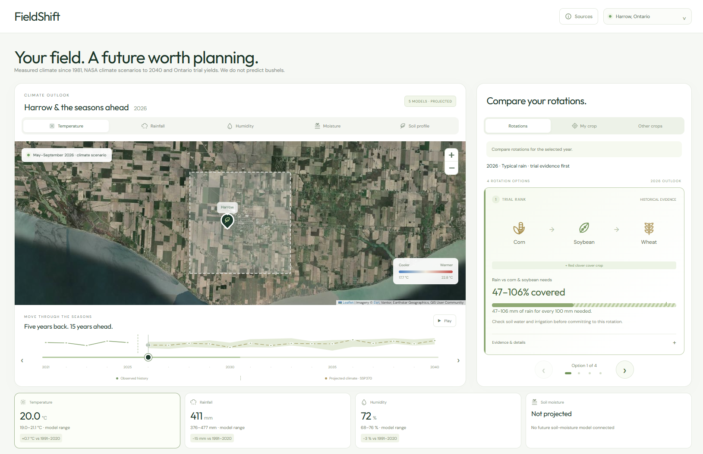
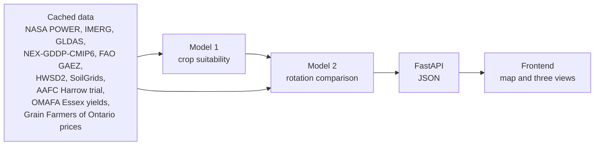

# FieldShift Forecast

FieldShift Forecast gives Ontario farmers evidence-based crop rotation recommendations before they plant. It ranks rotations using real trial yields and shows where each number comes from.

We built an interactive tool for a Harrow, Ontario pilot. It combines cached NASA climate data (POWER, IMERG, GLDAS and NEX-GDDP-CMIP6 projections to 2040), FAO crop suitability, soil data and real trial yields from the Agriculture and Agri-Food Canada Harrow rotation trial.

Farmers can see which rotations held up best in the trial and how rain and temperature outlooks affect them. They can pick a crop and a target yield, replay the 2012 dry year, and browse other crops by suitability. Measured temperature at Harrow has risen about 0.75 °C per decade since 1981.

This answers the Field Shift challenge by turning NASA data into a planning aid for farm decisions as the climate changes. It matters because choosing a rotation is costly and hard to undo.

The scoring is transparent, not a black box. Every number shows its source and a label such as cached or derived. The tool compares historical trial evidence and does not predict yields.

The tool does not predict bushels in general, except for a labelled DERIVED corn climate range, 145 to 173 bu/ac in 2028, with the 2012 miss shown on screen.



## The problem

A farmer in Ontario has to choose what to plant next season: corn, soybeans or wheat. The climate is changing, so last year's decision may not hold.

We asked a simple question. What if farmers could use decades of NASA climate data and real trial evidence to compare their options before planting?

That is FieldShift Forecast. It gives farmers evidence to compare options. It does not guarantee an outcome.

The tool does not predict bushels in general, except for a labelled DERIVED corn climate range, 145 to 173 bu/ac in 2028, with the 2012 miss shown on screen.

## Challenge

- Event: NASA Space Apps Challenge 2026, Toronto
- Challenge: Field Shift, Adapting Farms with NASA Data
- Team Tuxedo: Vedant Soni, Ved Patel, Shlok Mehta, Dev Patel

## Project structure

```
Tuxedo/
├── backend/          FastAPI app, Model 1, Model 2, trend and climate code
├── frontend/         Dashboard (HTML, CSS, JavaScript, bundled Leaflet and fonts)
├── data/
│   ├── seed/         Cached datasets the app reads
│   ├── source/       Cached daily NASA records
│   └── metadata/     Download and validation records
├── docs/             Evidence, method and data source notes, screenshot
├── scripts/          One-time data fetch scripts (not needed to run the app)
├── tests/            pytest suite and browser check
├── Dockerfile
├── LICENSE
├── docker-compose.yml
└── requirements.txt
```

## What we built

A pilot for one field near Harrow, Ontario. The field is a sample square of cropland, not a surveyed farm.

The dashboard has three views:

- **Rotations.** The rotations that have Harrow trial yields, one at a time, with the evidence behind each one.
- **My crop.** Pick corn, soybean or wheat, and optionally a bu/ac target. Each rotation shows whether the trial figures meet your target.
- **Other crops.** Suitability only, for crops outside the trial. No bushels and no revenue.

It also has:

- A year slider from 2021 to 2040. Years up to 2025 use observed NASA data. Later years use five NASA climate models (scenario SSP370).
- A past-season replay for any year from 1981 to 2025, with the 2012 dry year highlighted.
- A long-term temperature trend for the field.

## How it works

All data is fetched once and cached in the repo. The app never calls an outside API while it runs.



**Model 1, crop suitability.** For corn, soybean and wheat it looks up the FAO GAEZ v5 suitability index at the field. It uses 2001 to 2020 for past years and 2021 to 2040 (SSP370) for future years. Beside each score it shows two checks: May to September rain against the FAO crop water need, and soil pH against the OMAFRA target. The checks are shown, never blended into the score.

**Model 2, rotation comparison.** A transparent rule-based scorer. It is not machine learning.

- Crop index = trial yield / best trial yield for that crop x 100.
- Rotation score = the average crop index of the crops that have a 5-year trial yield.
- Gain over continuous cropping, from the same trial.
- Gross revenue = trial yield x a dated Grain Farmers of Ontario price. No costs, so no profit.

Yields are historical trial values from the AAFC Harrow trial at Woodslee. They are not forecasts.

**How the year changes the list.** Each year is checked against NASA rain. If May to September rain falls in the driest third of 1991 to 2020, the year is "dry-leaning" and the list uses the 2012 dry-year order. Otherwise it uses the trial evidence order. Observed years use NASA POWER rain. Future years use a vote of the five climate models. Trial yields never change with the year.

**Corn climate range.** For corn only, a model fitted on Essex County yields and NASA POWER weather gives a climate-adjusted range in future years. It is labelled DERIVED. Soybean and wheat did not beat "no change" in testing, so they get no adjustment.

## Tech stack

- **Backend:** Python 3.11, FastAPI, Uvicorn, SQLAlchemy (SQLite by default, PostgreSQL optional with psycopg)
- **Data and models:** NumPy, SciPy, pymannkendall, netCDF4, rasterio, access-parser
- **Frontend:** HTML, CSS and plain JavaScript, Leaflet 1.9.4 (bundled), DM Sans and Outfit fonts (bundled). The satellite basemap loads from Esri when online. Everything else works offline.
- **Tests:** pytest, Playwright (browser check)
- **Optional:** Docker with PostgreSQL 16

## Getting started

You need Python 3.11 and git.

```bash
git clone https://github.com/GitVed/Tuxedo.git
cd Tuxedo
```

Create and activate a virtual environment.

Windows:

```bash
py -3.11 -m venv .venv
.venv\Scripts\activate
```

macOS or Linux:

```bash
python3.11 -m venv .venv
source .venv/bin/activate
```

Install and run:

```bash
pip install -r requirements.txt
python -m uvicorn backend.app:app --port 8765
```

Open http://localhost:8765/frontend/

The local SQLite cache builds itself on first start.

### Run the tests

```bash
python -m pytest
```

Browser check (optional, needs the server running):

```bash
python -m playwright install chromium
python tests/browser_check.py --url http://127.0.0.1:8765
```

### Optional, Docker with PostgreSQL

The demo does not need Docker.

```bash
POSTGRES_PASSWORD=choose-one docker compose up --build
```

Then open http://localhost:8000/frontend/

## API overview

All routes return JSON. Interactive docs are at http://localhost:8765/docs while the server runs.

| Route | What it returns |
|---|---|
| `GET /api/pilot` | Field location, sample field square and trial site |
| `GET /api/timeline/harrow` | Climate by year 2021 to 2040, soil and data sources |
| `GET /api/recommendations/harrow?year=&must_grow=&need_bu=` | Ranked rotations for a year, with optional crop and bu/ac target |
| `GET /api/rotation/harrow?scenario=&must_grow=&need_bu=` | Rotations for the normal, 2012 dry or 2035 scenario |
| `GET /api/crops/harrow` | Other crops, suitability only |
| `GET /api/detect/{cell_id}` | Temperature, rain and soil-moisture trend for a cell |
| `GET /api/predict/harrow` | Crop suitability and dry-year stress facts |
| `GET /api/season/harrow?year=` | One past season, 1981 to 2025 |
| `GET /api/climate-yield/harrow` | Corn climate-yield test results and projected ranges |
| `GET /api/trend/{cell_id}` | Trend test results for a climate cell |
| `GET /api/series/{cell_id}` | Monthly climate series for a climate cell |

## Data sources and licences

- NASA POWER, GPM IMERG, GLDAS and NEX-GDDP-CMIP6: public domain, source cited
- ISRIC SoilGrids: CC BY 4.0
- ESA WorldCover: CC BY 4.0
- FAO GAEZ v5 and FAO/IIASA HWSD v2: free use with attribution
- Harrow trial data: AAFC. Cite Dr. Craig Drury and AAFC Harrow
- Essex County yields: OMAFA, through the Ontario Data Catalogue
- Prices: Grain Farmers of Ontario monthly averages
- Kaggle datasets (Other crops climate check only): as per each dataset's Kaggle licence

Every dataset, link and check is listed in [docs/DATA_SOURCES.md](docs/DATA_SOURCES.md).

## Team and license

Team Tuxedo, NASA Space Apps Toronto 2026: Vedant Soni, Ved Patel, Shlok Mehta, Dev Patel.

License: MIT. See [LICENSE](LICENSE).
